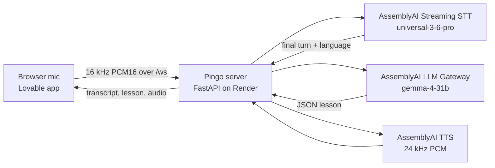

# Pingo

Pingo is a real-time voice tutor for language learners, built only on AssemblyAI. The learner says a word or phrase. Pingo replies with a translation, a pronunciation guide and one short tip, then speaks the phrase. This repo is the backend for an AssemblyAI Applied AI Engineer take-home. The tutor is the demo, and the evaluation below is the pitch.

Live app: [pingo-ai.lovable.app](https://pingo-ai.lovable.app) (UI built in Lovable). Backend: [pingo-voice-backend.onrender.com](https://pingo-voice-backend.onrender.com) (this repo, a WebSocket server). The API key stays on the server.

## Architecture



| Part | What Pingo uses | Settings |
|---|---|---|
| Frontend | Lovable app ([pingo-ai.lovable.app](https://pingo-ai.lovable.app)) | Mic captured at 16 kHz `pcm_s16le`, sent over one WebSocket |
| Backend | Python FastAPI WebSocket server (`server/`), hosted on Render | Holds the only API key; CORS/Origin check, per-IP limits |
| Speech-to-text | AssemblyAI Streaming STT, model `universal-3-6-pro` (official Python SDK) | Language detection on, `balanced` mode, 600 / 2,400 ms turn silence, Voice Focus `far-field`, profanity filter off, no keyterms |
| Tutor LLM | AssemblyAI LLM Gateway, model `gemma-4-31b` | Temperature 0.2, max 450 tokens, strict JSON via `response_format` |
| Text-to-speech | AssemblyAI TTS (`tts.us.assemblyai.com`), 24 kHz PCM | One voice per language: `aai-kyla` (English), a Spanish voice id, `aai-donatien` (French), `aai-magdalena` (German), `aai-giada` (Italian), `aai-nelson` (Portuguese) |
| Eval judge | AssemblyAI LLM Gateway, `gemma-4-31b`, temperature 0 | Only for the semantic WER row |

Everything runs on one vendor and one key (`ASSEMBLYAI_API_KEY`).

On each finished turn (`end_of_turn` with words), the server asks the tutor model for a structured lesson and streams the TTS back. The model also decides whether the turn is an attempt at the pending phrase and grades it. Partials only update the on-screen transcript. STT detects 32 languages, and TTS and tutoring cover six: English, Spanish, French, German, Italian and Portuguese.

## Run it

Python 3.12+ (Render uses 3.12.11).

```bash
git clone https://github.com/luharry2821/pingo-voice-backend.git
cd pingo-voice-backend
python3 -m venv .venv && source .venv/bin/activate
pip install -r requirements.txt
export ASSEMBLYAI_API_KEY=your_key      # or cp .env.example .env
python -m server                        # 127.0.0.1:8000, GET /health, WS /ws
```

Flags: `--config` (default `configs/baseline.yaml`, or `PINGO_CONFIG`), `--host`, `--port` (or `PORT`), `--target-language`, `--log`, `--set stt.max_turn_silence=1800` (repeatable).

Frontend: the UI is the Lovable app at [pingo-ai.lovable.app](https://pingo-ai.lovable.app); it isn't in this repo. It connects to `VITE_BACKEND_WS_URL`, which defaults to `wss://pingo-voice-backend.onrender.com/ws`. To use a local backend, build the frontend with `VITE_BACKEND_WS_URL=ws://127.0.0.1:8000/ws` and serve it from `localhost`. The server already accepts `localhost` origins (`server/app.py`), so nothing else needs changing.

Deploy: `render.yaml` is a Blueprint for a free Python service (`python -m server --host 0.0.0.0 --port $PORT`), with `ASSEMBLYAI_API_KEY` set in the dashboard. The free plan sleeps after 15 minutes, so `.github/workflows/keep-warm.yml` pings `/health` every 10 minutes.

## Configuration

Later sources win: defaults in `server/config.py` → YAML → `PINGO_*` env vars → `--set`. Each browser `start` / `update_config` message is merged per session, so one learner's changes don't affect another. An empty client `prompt` does not clear the server prompt.

| Setting | Baseline | Why |
|---|---|---|
| `stt.speech_model` | `universal-3-6-pro` | 32 languages, native code-switching |
| `stt.language_detection` | `true` | `language_code` and `language_confidence` on each turn |
| `stt.language_codes` | `[]` | Open to all 32 languages |
| `stt.prompt` | short learner-context string | Context about the audio, not instructions |
| `stt.keyterms_prompt` | `[]` | Off. Boosting the target phrase can make STT "hear" the correct form and hide a learner's mistake. |
| `stt.agent_context_enabled` | `false` | Off, for the same reason |
| `stt.mode` | `balanced` | Turn-taking preset |
| `stt.min_turn_silence` | `600` ms | Up from 128 ms so a short thinking pause doesn't end the turn (400 cut learners off in live use) |
| `stt.max_turn_silence` | `2400` ms | Up from 1,280 ms. |
| `stt.interruption_delay` | `250` ms | Down from 500 ms so Pingo stops sooner when talked over |
| `stt.vad_threshold` | `0.2` | Documented default, sent explicitly |
| `stt.voice_focus` | `far-field` | Laptop mics, threshold left at the default |
| `stt.filter_profanity` | `false` | Masking would rewrite what the learner said |
| `llm.model` / `temperature` / `max_tokens` | `gemma-4-31b` / `0.2` / `450` | Strict JSON via `response_format`, consistent lessons |
| `tts.voices` | one per language | Catalog voices, plus a voice id for Spanish |

Access control: `PINGO_ALLOWED_ORIGINS`, `PINGO_ALLOWED_ORIGIN_REGEX`, `PINGO_MAX_CONNECTIONS_PER_IP` (default 3), `PINGO_MAX_NEW_CONNECTIONS_PER_IP_PER_MINUTE` (default 10) and `PINGO_TRUST_PROXY_HEADERS` (on by default under Render).

Protocol: the client sends `start` (`target_language`, optional `native_language` and `config`), binary PCM16 frames, `update_config`, `set_target`, `replay` and `stop`. The server sends `status`, `transcript` (partial or final, with language), `lesson`, `agent_text`, `tts_start` + PCM + `tts_end`, `barge_in` and `error`.

## Key decisions

- **One vendor, one key.** STT, LLM Gateway and TTS are all AssemblyAI, server-side.
- **Act on finished turns only.** Partials are displayed, never acted on.
- **Language labels are hints.** Wrong labels at high confidence do happen: in the benchmark run, the hesitation sounds in a Spanish clip (`h13`, "eh…") came back as Chinese at confidence 1.0. So the rules rely on persistence rather than a single score:
  - Changing the learner's own language takes **two consecutive** turns in the same language, each with ≥ 3 words and confidence ≥ 0.6, in a TTS language that isn't the target.
  - A turn is treated as a request about a third language if it's in a non-Latin script, or if it's Latin-script with confidence ≥ 0.5. Either way, the tutor prompt always carries the label and its score.
- **Keyterms and agent context off,** so STT doesn't normalize away the learner's mistakes.
- **The LLM grades practice attempts** (`correct` / `close` / `try_again`). The server pins the stored phrase on attempts, so the lesson card shows the phrase being practised. A longer phrase that contains the stored one ("Hola, ¿cómo estás?" after "Hola") counts as a new phrase. After two misses, Pingo reads the phrase slowly, syllable by syllable.
- **Who may connect.** CORS and a WebSocket Origin check allow only the Lovable app, its previews and localhost. Each IP gets at most 3 open sockets and 10 new ones a minute. There are no accounts; this is a demo endpoint.
- **TTS sessions are reused.** On the free plan the account can open 5 new TTS sessions a minute (paid plans start at 200, per AssemblyAI's [rate limits](https://www.assemblyai.com/docs/streaming/rate-limits)), so each connection warms one session per voice on `start`.

Pricing, from [AssemblyAI pricing](https://www.assemblyai.com/pricing) as of 12 November 2026: streaming is $0.45/hr of open session time, idle included. `gemma-4-31b` costs $0.14 / 1M input tokens and $0.40 / 1M output tokens. TTS costs $15 / 1M characters. Each turn's log line records its usage.

## Evaluation and benchmarking Deepgram (assumed competitor in this deal)

**Verdict: AssemblyAI is more accurate than both Deepgram models (WER, entities, sentence errors, English, Spanish and English + Spanish code-switching).**

The same 105 clips were streamed live to each provider from one machine and scored with the same `score.py`. Results: [`assemblyai`](archive/test_cases/bench/assemblyai/RESULTS.md), [`deepgram`](archive/test_cases/bench/deepgram/RESULTS.md), [`flux`](archive/test_cases/bench/flux/RESULTS.md). Raw output, with each provider's session or request id per clip, is in `archive/test_cases/bench/*_raw.jsonl`.

### Scorecard

Error rates and latency: lower is better. The winner of each pair is in bold; no bold means there's no clear winner. Nova-3 is compared with AssemblyAI on all 105 clips. Flux returned results on 93 of 105 clips; it does not support Chinese or Korean.

| Metric | AssemblyAI U3.6 Pro (n=105) | Deepgram Nova-3 (n=105) | Deepgram Flux (n=93) |
|---|---|---|---|
| WER (average), normalized (84 clips / 553 words) | **6.33%** | 9.76% | 9.22% |
| Semantic WER, LLM judge (84 clips) | **2.71%** | 4.52% | 4.52% |
| Missed entity rate | **5.88%** (2/34) | 20.59% (7/34) | 19.35% (6/31) |
| Sentence error rate | **23.81%** | 28.57% | 31.18% |
| Hard-set WER (26 clips / 157 words) | **10.83%** | 19.11% | 15.92% |
| English WER (22 clips / 183 words) | **0.55%** | 4.37% | 4.37% |
| Spanish WER (24 clips / 138 words) | **7.97%** | 15.22% | 11.59% |
| Hindi WER (1 clip / 12 words) | 0.0% | 0.0% | 0.0% |
| Code-switching WER (English + Spanish, average, 8 clips / 54 words) | **14.81%** | 27.78% | 27.78% |
| TTFT from speech start¹, p50 / p90 (from stream start) | 368 / 462 ms (1,055 / 1,181) | 378 / 473 ms (1,067 / 1,170) | 356 / 577 ms (1,058 / 1,294) |

1. **TTFT** is the time from the first audio frame sent to the first result with words. AssemblyAI's published definition counts from the start of the stream, which is the figure in parentheses. Every clip opens with silence, measured per clip from the WAV as the first sample above −40 dBFS: 601–890 ms, median 704 ms. The main figure subtracts that clip's lead silence, so it counts from the start of speech.
2. **Settings, matched as closely as Deepgram allows.** No keyterms were sent on either side: Pingo's baseline sends AssemblyAI none, so Deepgram got none either.

   | AssemblyAI (Pingo baseline) | Deepgram Nova-3 (`/v1/listen`) | Deepgram Flux (`/v2/listen`) |
   |---|---|---|
   | `universal-3-6-pro`, `language_detection` | `nova-3`, `language=multi` | `flux-general-multi` |
   | `min_turn_silence` 600 | `endpointing=600` | no equivalent (`eot_threshold` 0.7, default) |
   | `max_turn_silence` 2400 | `utterance_end_ms=2400` | `eot_timeout_ms=2400` |
   | semantic end-of-turn check | no equivalent; ends on silence | semantic end of turn |
   | learner-context `prompt` | no equivalent | no equivalent |
   | `voice_focus` far-field, `vad_threshold` 0.2 | no equivalent (`vad_events` on) | no equivalent |
   | keyterms: none | keyterms: none | keyterms: none |
   | `filter_profanity` off | `profanity_filter=false` | n/a |
   | formatting built in | `smart_format`, `punctuate`, `interim_results` | built in |
3. Semantic WER uses the same judge for every arm: AssemblyAI LLM Gateway `gemma-4-31b` at temperature 0. That's the vendor's own model, so the plain WER rows are the ones that rely on no judge.
4. A stream that returned no turns was retried, up to 4 attempts. AssemblyAI streams were spaced at least 12.5 s apart, to stay within the free plan's new-sessions-per-minute limit of 5 (paid plans start at 200, per AssemblyAI's [rate limits](https://www.assemblyai.com/docs/streaming/rate-limits)). One clip was retried on each of AssemblyAI and Nova-3. All 303 streams returned transcripts.

### How we calculate

All numbers come from `archive/test_cases/score.py`, the same code for every provider. A clip's hypothesis is its final turns joined with spaces. S, D, I = substituted, deleted, inserted words from a `jiwer` alignment; N = reference words.

- **Normalization (WER rows):** English-only clips use Whisper's `EnglishTextNormalizer`. All other clips use a Whisper-style basic normalizer: NFKC, lowercase, drop `<…>`/`[…]` tags and `(…)` asides, turn punctuation and symbols into spaces (combining marks kept, for Devanagari), collapse whitespace. Japanese, Chinese and Korean clips are scored per character (CER) and are not in any WER row.
- **WER (average)** = (ΣS + ΣD + ΣI) / ΣN, pooled over all word-based clips (84 clips / 553 words). Pooled means total errors over total words, not a mean of per-clip rates.
- **English / Spanish / Hindi WER** = the same formula over clips whose only language is `en`, `es` or `hi`. Mixed-language clips are not included.
- **Code-switching WER (English + Spanish, average)** = (S + D + I) / N pooled over the 8 clips whose `languages` are exactly `en` and `es`. Each word must be transcribed in the language spoken.
- **Semantic WER** = Σ meaning-changing errors / ΣN over the same 84 clips. One batched LLM-judge call (AssemblyAI LLM Gateway `gemma-4-31b`, temperature 0) gets each clip's reference, hypothesis and error list and returns how many of those errors change the meaning; each clip's count is capped at its error count.
- **Missed entity rate** = tagged entities not found in the hypothesis / all tagged entities. Matching uses the WER normalization and a whole-word match (CJK: substring match with spaces removed).
- **Sentence error rate** = clips with at least one word (or, for CJK, character) error after normalization / all clips.
- **Hard-set WER** = WER (average) over the word-based clips flagged `hard` (26 of the 31-clip hard set; the other 5 are CJK).
- **TTFT from speech start** = (time of the first result with words − time the first audio frame was sent) − the clip's lead silence. Lead silence = time to the first sample above −40 dBFS (|sample| > 328) in the WAV. p50 / p90 use linear interpolation between ranks. Times are stamped client-side.

### Test set

105 synthetic edge-tts clips, listed in `archive/test_cases/cases.jsonl`. Every clip, with its audio and each provider's session ID, is in the [Notion test cases table](https://heavenly-comb-246.notion.site/Pingo-STT-Test-Cases-105-416ff952949a81dcb6b8c0c8cb4c6b89). Endpointing is matched on both providers (600 / 2,400 ms). By design there's no 1,280 ms arm.

| Language | Clips |
|---|---|
| en | 22 |
| es | 24 |
| de | 12 |
| ja | 9 |
| zh | 7 |
| fr | 7 |
| ko | 5 |
| it | 3 |
| hi | 1 |
| en+es mixed | 8 |
| en+hi mixed | 7 |

### Worked examples

These come from the runs above.

| Clip | Spoken | AssemblyAI | Deepgram Nova-3 | Deepgram Flux |
|---|---|---|---|---|
| `ent09` entities | Dr. Nguyen booked a flight to São Paulo on November 3rd. | Dr. Nguyen booked a flight to São Paulo on November 3rd. (0 errors) | Dr. Ngwin booked a flight to Sao Paulo on November 3. (2 errors) | Doctor. Nguyen booked a flight to Sao Paulo on November third. (0 errors after normalization) |
| `h20` accented es | Quiero un café, por favor. | Quiero un café, por favor. (es, 0 errors) | Quero Uncafé or favor. (labelled en, 4 errors) | Quero un cafe or favor. (labelled en, 3 errors) |
| `cs04` en+es | I think the answer is muy bien. | I think the answer is muy bien. (0 errors) | I think the answer is Muibian. (2 errors) | I think the answer is Muibian. (2 errors) |
| `hi02` en+hi (AssemblyAI loses) | Aaj मेरी Spanish class है। | आज मेरी स्पैनिश क्लास है। (3 errors: English words written in Devanagari) | आज मेरी Spanish class है. (1 error) | आज मेरी Spanish class है. (1 error) |
| `h13` hesitation | Yo... eh... yo fui, no, yo voy al mercado. | 就。 / 哎。 / Yo fui, no, yo voy al mercado. (3 turns; fillers labelled zh at confidence 1.0) | Jo E. Yo fui, no, yo voy al mercado. (1 turn) | Yo. / Yo fui, no, yo voy al mercado. (2 turns) |
| `zh02` Chinese | 请问洗手间在哪里？ | 请问洗手间在哪里？ (0 errors) | 请问洗手间在哪里 (0 errors) | not supported |

Rerun everything with `python archive/test_cases/stt_bench.py assemblyai|deepgram|flux`, then `python archive/test_cases/score.py archive/test_cases/bench/<arm>_raw.jsonl --out=archive/test_cases/bench/<arm>`. For Flux, add `--ids-from=archive/test_cases/bench/flux_raw.jsonl`. Keys are read from `ASSEMBLYAI_API_KEY` and `DEEPGRAM_API_KEY` and are never written to disk.

## Customer evaluation approach

This is the general playbook for evaluating AssemblyAI against a customer's current STT vendor, and the Deepgram benchmark above is one run of it.

Deck: [Download PDF](https://docs.google.com/presentation/d/19ONortiO_VXuuLI4CCLz57Dc7efuQG7tZYXsZ4r15Kc/export/pdf) · [View in Google Slides](https://docs.google.com/presentation/d/19ONortiO_VXuuLI4CCLz57Dc7efuQG7tZYXsZ4r15Kc/edit) · [Customer Evaluation page](https://pingo-ai.lovable.app/evals/customer)

### 1. Understand

- **Discovery.** Learn what they're building, the product and its flow architecture. Find the user pain, review the current STT setup and collect real learner audio. *Goal: what they built, where learners struggle, and the baseline to beat.*
- **Success criteria.** Find out how they measure today, whether they measure it correctly, which KPIs they track and where the blind spots are. *Goal: their product through its KPIs, and whether those numbers hold up.*

### 2. Build the benchmark

- **Source of truth.** Use human transcripts first, then models outside both vendors, and keep learner mistakes as spoken. *Goal: a fair answer key that no vendor wrote.*
- **Truth File Corrector.** Load the answer key into AssemblyAI, check it against the audio, and fix the labels, not the models. *Goal: a corrected source of truth we can trust.*

### 3. Run and score

- **Run, score and validate.** Stream every clip live to Universal-3.6 Pro at real-time pace, then re-run the current vendor on the same audio with the closest matching endpointing. Vendors get audio and settings only; the answer key stays with us. Score from raw output saved with session IDs. *Goal: same audio, same scoring, nothing hidden.*
- **What we measure.**
  - *Accuracy:* WER, FWER, sentence error rate, semantic WER, missed entity rate and code-switching WER.
  - *Latency:* TTFT, TTCT, end-of-turn latency and turns that never end, all at p50 and p90.
  - *Pricing:* cost per learner hour, session time with pauses included, and add-ons in use.

### 4. Improve and decide

- **Diagnose, tune and pilot.** Group the failures, tune one setting at a time, re-score and repeat, then pilot with go-live criteria. *Goal: a clear yes, backed by their own data.*

## Repository files

| Path | What it is |
|---|---|
| `README.md` | This file |
| `.env.example` | Template for `ASSEMBLYAI_API_KEY` (copy to `.env`) |
| `.gitignore` | Files git ignores (`.env`, venv, caches) |
| `requirements.txt` | Runtime Python dependencies |
| `requirements-dev.txt` | Extra dependencies for tests and the eval |
| `render.yaml` | Render Blueprint for the free Python web service |
| `.github/workflows/keep-warm.yml` | Pings `/health` every 10 minutes so the free Render service doesn't sleep |
| `configs/baseline.yaml` | Shipped STT, LLM and TTS defaults |
| **`server/`** | **The backend** |
| `server/__init__.py` | Package overview: the pipeline and what each module does |
| `server/__main__.py` | `python -m server` entry point; starts uvicorn |
| `server/app.py` | FastAPI app: `/health`, the `/ws` WebSocket, CORS/Origin check and per-IP limits |
| `server/session.py` | One learner session: STT events, language rules, practice state, barge-in, TTS plan, log |
| `server/stt.py` | AssemblyAI streaming STT client (official Python SDK) |
| `server/llm.py` | The tutor: AssemblyAI LLM Gateway call, JSON lesson schema and cleanup |
| `server/tts.py` | AssemblyAI WebSocket TTS client |
| `server/config.py` | Defaults, YAML, `PINGO_*` env vars, `--set`, per-session merge |
| `server/audio.py` | WAV to 16 kHz mono PCM16, used by the eval scripts |
| `server/log.py` | Appends one JSONL line per final learner turn |
| **`archive/tests/`** | **Unit tests, fake STT/LLM/TTS, no network** |
| `archive/tests/test_backend.py` | End-to-end pipeline with fake AssemblyAI clients |
| `archive/tests/test_tutor.py` | Tutor schema, practice state and speech plan |
| `archive/tests/test_routing.py` | Native-language turns are new phrases, not attempts |
| `archive/tests/test_other_language.py` | Third-language speech is taught; language-confidence rules |
| `archive/tests/test_barge_in.py` | Barge-in while the browser is still playing audio |
| `archive/tests/test_glitches.py` | Cleanup of bad model replies seen in production |
| `archive/tests/test_salvage.py` | Truncated model replies still teach their finished fields |
| `archive/tests/test_voice_focus.py` | Voice Focus and profanity-filter settings |
| `archive/tests/test_score.py` | Scoring logic in `archive/test_cases/score.py` |
| **`archive/test_cases/`** | **The evaluation** |
| `archive/test_cases/README.md` | How the test set and benchmark work |
| `archive/test_cases/cases.jsonl` | The 105 cases: reference text, languages, entities, tags |
| `archive/test_cases/audio/` | One 16 kHz mono WAV per case (105 files) |
| `archive/test_cases/make_cases.py` | Builds `cases.jsonl` and the WAVs with edge-tts |
| `archive/test_cases/stt_bench.py` | Streams every clip live to AssemblyAI, Deepgram Nova-3 or Flux |
| `archive/test_cases/score.py` | Scores one provider's raw output: WER, semantic WER, entities, SER, TTFT |
| `archive/test_cases/latency.py` | End of speech to first reply audio through Pingo's `/ws` |
| `archive/test_cases/latency_raw.jsonl` | Raw output of `latency.py` |
| `archive/test_cases/bench/*_raw.jsonl` | Raw benchmark output per provider, with session/request ids |
| `archive/test_cases/bench/assemblyai/`, `deepgram/`, `flux/` | Scored results per provider (`results.json`, `RESULTS.md`) |
| **`yc-demo/`** | **YC extra credit: the voice-clone demo (React + Vite, Vercel Functions in `api/`, shared server code in `server/`)** |

## Extra credit: YC demo

Live: [yc-clone-scrib-ai.vercel.app](https://yc-clone-scrib-ai.vercel.app)

Code: [`yc-demo/`](yc-demo/) in this repo. It's a standalone app with its own front end and Vercel Functions backend (`yc-demo/api/`, `yc-demo/server/`), separate from Pingo's Python backend. Its own [README](yc-demo/README.md) has the full details.

"I'm a solo YC founder building a company." Harry, the founder of Pingo AI, has three calls today: Mom, a new engineer and an upset customer. His **AssemblyAI voice clone** takes them. Two AI voices talk turn by turn, and each side really listens: every spoken line is transcribed by AssemblyAI streaming STT, and the other side only ever sees what STT heard. The customer call code-switches in Hinglish.

How a turn works:

1. **LLM Gateway** (`gemma-4-31b`, falls back to `qwen3.5-4b-32k-fast`) writes the speaker's next line. Harry gets no script, only a brief (goal, intent, what to get across, optional attached doc).
2. **TTS** speaks it: Harry with your cloned `voice_id`, the counterparts with stock voices (`aai-kyla`, `aai-titus`, `aai-audrey`).
3. **Streaming STT** (`universal-3-6-pro`, temporary token minted server-side) transcribes the line as it plays, with live partials. Pre-recorded STT is the fallback.
4. The other side's LLM gets only that transcript and replies.

Stack: React + Vite + Tailwind front end, Vercel Functions in `api/` for chat, TTS, the STT token and the STT fallback. The API key is read only by those functions.

Run it locally:

```bash
cd yc-demo
cp .env.example .env     # set ASSEMBLYAI_API_KEY=...
npm install
npm run dev              # http://localhost:5173
```

Open the gear icon (top right), paste your cloned voice ID (from the AssemblyAI dashboard, Voices), and press **Test my clone**. With no voice ID it uses the stock voice `aai-ewald`. Pick a call and press play.

Deploy: import the repo in Vercel with root directory `yc-demo` (framework: Vite) and set `ASSEMBLYAI_API_KEY`. If the key is missing, every API route returns `500 {"error":"missing_server_secret"}`.
