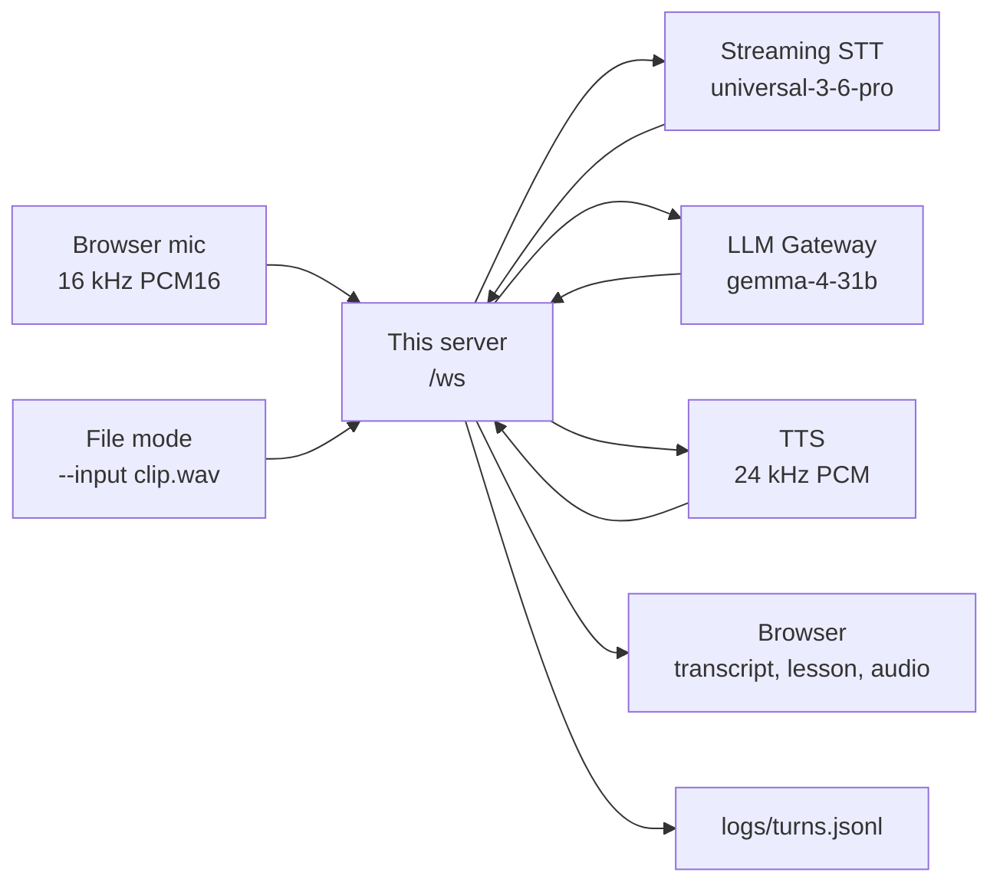

# Pingo

Pingo is a real-time voice tutor for language learners, built only on AssemblyAI. This repository is the backend for an AssemblyAI Applied AI Engineer take-home: the demo is the tutor, and the pitch is the evaluation approach and the product decisions that followed. The learner says a word or phrase; Pingo answers with a translation, a pronunciation guide, and one short tip, then speaks the phrase.

Live app: [https://pingo-ai.lovable.app](https://pingo-ai.lovable.app). Backend: [https://pingo-voice-backend.onrender.com](https://pingo-voice-backend.onrender.com). This repo is the WebSocket server only; the browser UI lives in Lovable. The API key stays server-side and never reaches the browser.

## Architecture

Browser mic (16 kHz `pcm_s16le`) → this server (`/ws`) → AssemblyAI streaming STT (`universal-3-6-pro`) → AssemblyAI LLM Gateway (`gemma-4-31b`) → AssemblyAI TTS (24 kHz PCM) → browser. One vendor, one key (`ASSEMBLYAI_API_KEY`).



On each finished turn (`end_of_turn`), the server asks the tutor model for a structured lesson (the model also decides whether the turn is an attempt at the pending phrase and grades it), and streams TTS audio back. Partials only update the on-screen transcript. File mode (`python -m server --input clip.wav`) uses the same `Session` class, paced in real time, so evals run the live pipeline.

STT detects any of 32 languages; TTS and tutoring speak six: English, Spanish, French, German, Italian, and Portuguese.

## Quick start

Python 3.12 or newer (Render deploys **3.12.11**).

```bash
python3 -m venv .venv
source .venv/bin/activate
pip install -r requirements.txt
export ASSEMBLYAI_API_KEY=your_key   # or: cp .env.example .env and fill it in (.env is gitignored)
python -m server
```

The process loads `configs/baseline.yaml` by default (`PINGO_CONFIG` or `--config` to change it). It binds `127.0.0.1:8000`. `GET /health` returns `{"ok": true}`. Point the frontend at `ws://127.0.0.1:8000/ws`.

Useful flags and env vars:

- `--host 0.0.0.0` to listen on all interfaces (Render does this).
- `--port 8000`, or the `PORT` environment variable (Render sets this; it overrides the YAML port). `--port` wins over `PORT`.
- `--set stt.max_turn_silence=1800` for one-off overrides (repeatable).
- `--input clip.wav --case-id id --session-id run-1 --log logs/turns.jsonl` runs one clip through the same pipeline. Exit `0` if at least one turn was logged, `1` if not, `2` if the key is missing. Spoken audio is written to `logs/last_reply.pcm` (24 kHz mono s16). `--no-pace` sends the file as fast as possible.

### Tests

`jiwer` and `whisper-normalizer` are not in `requirements.txt`, but `tests/test_score.py` imports `test_cases/score.py`, which needs them.

```bash
pip install jiwer whisper-normalizer
python -m unittest discover -s tests -t .
```

### Evaluation scripts

From the repo root. `requests` is already in `requirements.txt`. Semantic WER calls the LLM Gateway unless you pass `--no-judge`. Rebuild audio only if you change the cases (`edge-tts` is required for that step).

```bash
pip install jiwer whisper-normalizer          # scoring
pip install edge-tts                          # only to rebuild clips
python test_cases/make_cases.py               # optional: rebuild test_cases/audio/
python test_cases/run_render.py               # live /ws -> test_cases/raw_outputs.jsonl
# python test_cases/run_render.py ws://127.0.0.1:8000/ws test_cases/raw_outputs.jsonl
python test_cases/score.py                    # -> test_cases/results.json and RESULTS.md
python test_cases/score.py path.jsonl --no-judge
```

`run_render.py` defaults to `wss://pingo-voice-backend.onrender.com/ws`. Optional args are the WebSocket URL and the output JSONL path. `ONLY` (comma-separated case-id prefixes), `PER` (clips per session, default 15), and `CONC` (parallel sessions, default 2) are environment knobs.

### Deploy

`render.yaml` is a Blueprint for a free Python web service named `pingo-voice-backend` (`python -m server --host 0.0.0.0 --port $PORT`). Set `ASSEMBLYAI_API_KEY` in the dashboard; the Blueprint does not contain a value. After deploy, point the app at `wss://<service>.onrender.com/ws`.

The free plan sleeps after 15 minutes without traffic; the first request after that can take about a minute. `.github/workflows/keep-warm.yml` pings `/health` every 10 minutes.

## Configuration

Precedence, later wins: built-in defaults in `server/config.py` → YAML (`configs/baseline.yaml` unless `--config` / `PINGO_CONFIG`) → `PINGO_*` environment variables → `--set key.path=value`. A browser `start` / `update_config` is then merged per session, so one learner's tweaks do not leak into another.

An empty client `prompt` does not clear the server prompt (the Lovable client sends `"prompt": ""` on every start). `keyterms_prompt: []` does turn keyterms off.

| Setting | Baseline | Why |
|---|---|---|
| `stt.speech_model` | `universal-3-6-pro` | 32 languages, native code-switching |
| `stt.language_detection` | `true` | `language_code` and `language_confidence` on the turn |
| `stt.language_codes` | `[]` (omitted) | Empty means any of the 32 languages. A non-empty list is sent and biases those languages; the baseline leaves it empty. |
| `stt.prompt` | short learner-context string | Sent when non-empty, max 1750 characters. Context about the audio, not instructions. |
| `stt.keyterms_prompt` | `[]` (omitted) | Off. Boosting the target phrase can make STT "hear" the correct form and hide a learner mistake. Max 100 terms, 50 characters each. |
| `stt.agent_context_enabled` | `false` | Off, same fidelity risk as keyterms. When on, the last spoken line is sent as `agent_context` (max 1750 characters). |
| `stt.mode` | `balanced` | Turn-taking preset. Sent on the connection; a mid-session change waits for the next `start`. |
| `stt.min_turn_silence` | `400` ms | Raised from the balanced preset (128 ms) so a short thinking pause does not end the turn. Judgment call, not A/B measured. |
| `stt.max_turn_silence` | `2400` ms | Raised from the balanced preset (1280 ms) so a long hesitation is not cut off. Judgment call, not A/B measured. |
| `stt.interruption_delay` | `250` ms | Lowered from the balanced preset (500 ms) so Pingo stops sooner when talked over. Judgment call, not A/B measured. |
| `stt.vad_threshold` | `0.2` | Documented default, sent explicitly so the log matches the session. Not tuned. |
| `stt.voice_focus` | `far-field` | For laptop mics. `near-field` or `off` are also valid. Threshold is unset (AssemblyAI default 0.5). |
| `stt.filter_profanity` | `true` | Sent only when true. Masks profane words in partial and final turns, first letter kept. Uses AssemblyAI's word list. |
| `llm.model` | `gemma-4-31b` | Sends `response_format` for the lesson schema. `PINGO_LLM_MODEL=qwen3.5-4b-32k-fast` selects the other model this key is set up to call; that one has no `response_format`. |
| `llm.temperature` | `0.2` | Consistent lessons. |
| `llm.max_tokens` | `450` | Caps the tutor JSON. Each spoken segment is also cut at 300 characters. |
| `llm.timeout_s` / `tts.timeout_s` | `30` | Client error names which call timed out. |
| `tts.sample_rate` | `24000` | Raw PCM streamed to the browser. |
| `tts.voices` | per language | `spanish` uses voice id `bff56a11-dc95-552e-a93a-59f68ca60b64`; the others use catalog slugs (`aai-kyla`, `aai-donatien`, `aai-magdalena`, `aai-giada`, `aai-nelson`). |
| `server.host` / `server.port` | `127.0.0.1` / `8000` | Local default. |
| `log.path` | `logs/turns.jsonl` | Append-only, gitignored. |

Environment overrides (all optional): `PINGO_STT_MODE`, `PINGO_STT_PROMPT`, `PINGO_STT_LANGUAGE_CODES`, `PINGO_STT_KEYTERMS_PROMPT` (JSON or comma-separated), `PINGO_STT_AGENT_CONTEXT`, `PINGO_STT_AGENT_CONTEXT_ENABLED`, `PINGO_STT_MIN_TURN_SILENCE`, `PINGO_STT_MAX_TURN_SILENCE`, `PINGO_STT_INTERRUPTION_DELAY`, `PINGO_STT_VAD_THRESHOLD`, `PINGO_STT_VOICE_FOCUS`, `PINGO_STT_VOICE_FOCUS_THRESHOLD`, `PINGO_STT_FILTER_PROFANITY`, `PINGO_LLM_MODEL`, `PINGO_LLM_TEMPERATURE`, `PINGO_LLM_MAX_TOKENS`, `PINGO_LLM_TIMEOUT`, `PINGO_LLM_SYSTEM_PROMPT`, `PINGO_TTS_SAMPLE_RATE`, `PINGO_TTS_TIMEOUT`, `PINGO_TTS_VOICE_SPANISH` (or `_ES`, and the same for the other five), `PINGO_LOG_PATH`, `PINGO_HOST`, `PINGO_PORT`, `PINGO_TARGET_LANGUAGE`, `PINGO_CONFIG`.

### Protocol (short)

Client → server: `{"type":"start","target_language":"es"}` (optional `native_language`, `case_id`, `session_id`, `config`; or `auto_target: true` / `target_language: "auto"`), binary 16 kHz PCM16 frames (~50 ms), `update_config`, `set_target`, `replay` (`phrase` / `slow` / `all`), `stop`.

Server → client: `status`, `transcript` (partial or final, including `language_code` and `language_confidence`), `lesson`, `agent_text`, `tts_start` + 24 kHz PCM + `tts_end`, `barge_in`, `error`. One turn can mix voices: explanations in the learner's language, the phrase in the target language, with 250 ms of silence between segments.

Target codes: `en`, `es`, `fr`, `de`, `it`, `pt` (or the full name, `spanish`). Default learner language is `en` until a later turn changes it.

## Key decisions

- **One vendor, one key.** Streaming STT, the LLM Gateway, and TTS all use `ASSEMBLYAI_API_KEY` on the server. The deprecated managed Voice Agent API is not used.
- **Finished turns only.** Language rules and the tutor call run only on a turn with `end_of_turn` and words. Partials are displayed, not acted on.
- **Language confidence is a hint, not a fact.** AssemblyAI's `language_confidence` is a 0–1 score, not a guaranteed probability. The 109-clip eval had a 13.68% confident-wrong rate (wrong label at ≥ 0.6; 16 / 117 turns), including a Spanish sentence labelled Korean at 1.0. The rules below are judgment calls, unit-tested in `tests/test_other_language.py`. They have not been measured in live use.
  - **0.6 plus 3 or more words (`NATIVE_MIN_WORDS`):** can change the learner's own language, and only to one of the six TTS languages, and never to the language being practised. A missing score does **not** block the change; only a numeric score below 0.6 does.
  - **Any confidence:** if the label is neither the learner's language nor the target, `_other_language` treats the turn as a third language to translate and teach. The tutor prompt always includes the label and score, or `"unknown"` if the score is missing, and the model can overrule a bad label. While a practice phrase is pending, the hint also tells the model that a mislabelled attempt is still judged as an attempt.
- **`language_codes` left empty.** STT stays open to all 32 languages. Narrowing the list is supported but was not adopted for the baseline.
- **Endpointing and barge-in.** `min_turn_silence` 400 ms and `max_turn_silence` 2400 ms (raised from the balanced presets of 128 / 1280). `interruption_delay` 250 ms (preset 500). These are judgment calls, not A/B measured. Barge-in fires on `SpeechStarted`, or on a new transcript with words, while Pingo is thinking, speaking, or still playing audio (`_agent_audible`).
- **Keyterms and agent context off.** Either can normalize away a planted mistake. Left off until an eval shows otherwise.
- **Voice Focus `far-field`, threshold unset.** Suits laptop mics. The threshold is left at AssemblyAI's default until an eval of planted mistakes supports a change.
- **Profanity filter on.** The tutor only sees the masked transcript.
- **`vad_threshold` 0.2.** Documented default, not tuned.
- **Structured tutor call, after the final turn.** `gemma-4-31b` with `response_format`, temperature 0.2, `max_tokens` 450. The server does not start the LLM on a partial, and TTS starts only after the full lesson JSON is parsed. A cancelled or unparsed reply is not spoken.
- **The LLM grades practice attempts.** There is no rule-based matcher. The tutor model gets the pending phrase, the transcript, the language label and score, and the number of misses so far, then returns `intent` and `verdict` (`correct`, `close`, `try_again`). The server keeps that verdict. It only pins the stored phrase on an attempt (so the card shows the phrase being practised, not what the model echoed), counts misses, and reads the phrase slowly by syllables after two misses. No eval measures grading accuracy yet.
- **Reuse TTS sessions.** The account may open only 5 TTS sessions a minute, so each connection keeps one session per voice and warms them on `start`. There is no TTS speed control; a slow read is syllables with pauses, then the whole phrase.

Published rates, from [AssemblyAI pricing](https://www.assemblyai.com/pricing) as of 12 November 2026 (PT): streaming `universal-3-6-pro` is $0.45/hr of open session time, including idle; `gemma-4-31b` is $0.14 / 1M input tokens and $0.40 / 1M output tokens; TTS is $15 / 1M characters. Each turn log includes `usage` quantities; this README does not compute a cost per turn or per hour.

## Evaluation

The main fidelity KPI is **mistake preservation**: planted learner mistakes must appear verbatim in the transcript, not be silently corrected. 109 short synthetic clips (edge-tts neural voices, 16 kHz mono, no production audio) cover accents, Japanese / Chinese / Korean (scored with CER), code-switching, formatting, two-speaker clips, planted mistakes, pause-fillers, entities, and a 31-case hard set. Definitions live in `test_cases/README.md`.

`test_cases/run_render.py` streams the clips through the live backend (default `wss://pingo-voice-backend.onrender.com/ws`): at most 2 parallel sessions, 15 clips per session, 4 s of silence after each clip. Final-turn transcripts during a clip and its silence are joined as the hypothesis. `test_cases/score.py` compares them with `test_cases/cases.jsonl` and writes `results.json` plus `RESULTS.md`.

Error rates: lower is better, except language-ID accuracy and mistake preservation (higher is better). *n* is cases / reference units (words, or characters for CER); language-ID metrics are per final turn. Numbers below are the committed live Render run in `test_cases/RESULTS.md`.

| KPI | Value | n |
|---|---|---|
| WER (normalized, word-based cases) | 6.35% | 88 / 598 |
| Semantic WER (LLM judge) | 2.51% | 88 |
| FWER (raw, no normalization) | 8.59% | 88 / 582 |
| Match error rate (`jiwer.mer`) | 6.34% | 88 / 599 |
| cpWER (2-speaker) | 17.78% | 4 / 45 |
| Mistake-preservation rate (higher is better) | 69.44% | 36 mistakes |
| Mistake-preservation, ambiguous audio excluded | 75.0% | 32 mistakes |
| Sentence error rate | 24.77% | 109 |
| Missed entity rate (MER) | 5.88% (2/34) | 18 cases |
| Missed entity rate, entity set only | 4.17% (1/24) | 10 cases |
| Language-ID accuracy (higher is better) | 80.34% | 94 / 117 turns |
| Confident-wrong rate (wrong label, confidence ≥ 0.6) | 13.68% | 16 / 117 turns |

**MER** here means missed entity rate (names, places, dates, numbers, brands that do not appear after the same normalization as WER, or CER for ja/zh/ko). `RESULTS.md` also reports match error rate under the heading "MER (match error rate, jiwer.mer)"; that is a different metric.

On the hard set (31 cases): WER 10.83% (26 / 157), mistake preservation 52.38% (21 mistakes) and 58.82% with ambiguous audio excluded (17 mistakes).

The language-confidence rules above are implemented and unit-tested. The eval scored the labels; it did not count how often those rules fired in a live conversation.

## Layout

| Path | What it does |
|---|---|
| `server/__main__.py` | CLI: WebSocket server, or `--input` file mode |
| `server/app.py` | FastAPI app, `GET /health`, `WS /ws` |
| `server/session.py` | One learner session: STT events, routing, practice state, barge-in, TTS plan, slow-read text, log |
| `server/stt.py` | SDK `RealTimeTranscriber` and the parameter rules |
| `server/llm.py` | Playground `requests.post` to the LLM Gateway |
| `server/tts.py` | SDK `TTSSession.speak`, one long-lived session per voice per connection |
| `server/config.py` | Defaults, YAML, env, `--set`, per-session merge |
| `server/audio.py` | WAV to 16 kHz mono PCM16, real-time chunking |
| `server/log.py` | Append one JSONL line |
| `configs/baseline.yaml` | Shipped defaults |
| `tests/` | Unit tests (fake STT, LLM, and TTS) |
| `test_cases/` | 109-clip set, runner, scorer, and committed results |
| `render.yaml` | Render Blueprint |

## Limitations and next steps

- TTS speaks six languages. STT understands many more, so Pingo cannot yet teach Japanese or Hindi.
- There is no phoneme-level pronunciation score. Grading is the LLM reading the transcript, so a strong accent that STT still transcribes as the target is judged correct, and grading can vary between runs.
- TTS cannot slow down; slow reads are syllables with pauses.
- Language-ID arrives in time for finished-turn decisions only. The 0.6 rule is unit-tested, not measured in live use. Next step: log how often it fires in live sessions.
- `SpeechStarted` barge-in can still be delayed until STT is sure speech has started, and browser echo can false-trigger it. Headphones or a higher `vad_threshold` help.
- The speech-end timestamp assumes STT word times start at the first audio byte this process sent. Compare `stt_final - speech_end` on a real clip before publishing latency numbers.
- No accounts, history, auth, or rate limiting. This is a reference server.
- TTS is not started from a partial LLM token; that remains a latency experiment.
