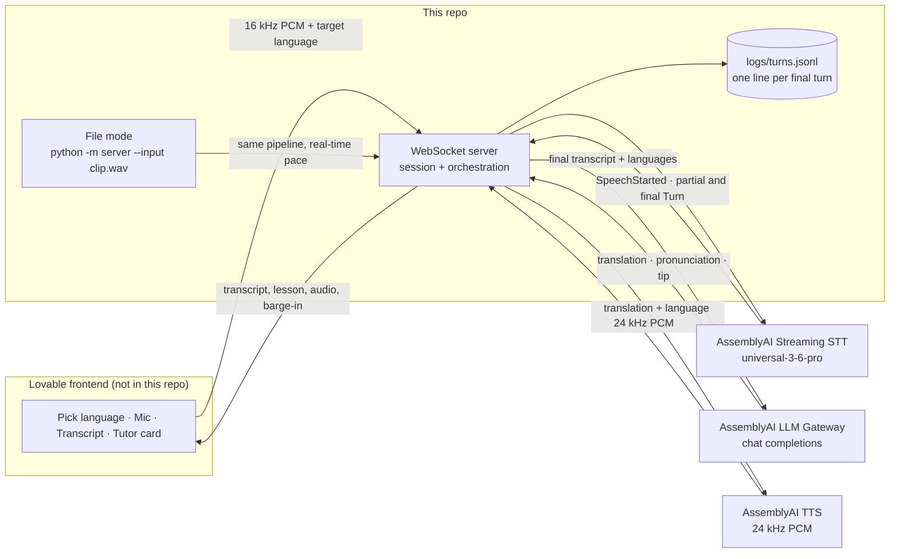

# Pingo

Pingo is a real-time voice tutor for language learners, built only on AssemblyAI. The learner says a word or phrase in any language Universal-3.6 Pro understands. The tutor answers with a translation, a pronunciation guide, and one short tip, then speaks the translation.

This repository is the **backend only**. The browser UI lives in Lovable and connects over one WebSocket. The API key never reaches the browser.



One turn:

1. The browser streams 16 kHz `pcm_s16le` audio. The server forwards it to streaming STT.
2. Partials update the transcript. `SpeechStarted` during a tutor reply cancels that reply and tells the browser to flush playback.
3. The final `Turn` (`end_of_turn: true`) carries words, confidence, and the detected language.
4. The LLM Gateway returns JSON: translation, pronunciation, tip, detected errors.
5. TTS speaks the translation. The server streams 24 kHz PCM back.
6. The server appends one JSONL line for that turn.

## Run it

```bash
python -m venv .venv
source .venv/bin/activate
pip install -r requirements.txt
cp .env.example .env
# put your key in .env — it is gitignored
python -m server
```

The server listens on `ws://localhost:8000/ws`. In the Lovable project, set:

```bash
VITE_BACKEND_WS_URL=ws://localhost:8000/ws
```

`localhost` works when the backend runs on the same machine as the browser. A local run binds `127.0.0.1:8000`. If `PORT` is set, that port is used instead. From another device, pass `--host 0.0.0.0`. `GET /health` returns `{"ok": true}`.

CORS is open so the Lovable-hosted page can connect. A new `start` on an existing socket closes the previous STT session and opens a fresh one. A dropped socket closes the upstream STT connection.

## Deploy on Render

`render.yaml` is a Blueprint for one free Python web service named `pingo-voice-backend`.

1. In Render: **New > Blueprint**, and pick this repo.
2. When it asks for `ASSEMBLYAI_API_KEY`, paste the key. The Blueprint does not contain a value.
3. After the deploy, set the Pingo app's backend URL to `wss://<service>.onrender.com/ws`.

The free tier sleeps after inactivity. The first connection after a sleep can take about 30–60 seconds while the service wakes up.

## WebSocket protocol

Client to server:

| Message | Meaning |
|---|---|
| `{"type":"start","target_language":"es","config":{...}}` | Open a streaming STT session. Optional `case_id`, `session_id`, and `native_language` (the learner's own language, one of the six codes; default `en`, otherwise learned from their longer non-practice turns). |
| `{"type":"start","auto_target":true,"config":{...}}` | Auto-target mode ("Ask Pingo"): no language picked up front. `target_language` may be omitted or `"auto"`. See [Auto-target mode](#auto-target-mode). |
| binary frames | PCM16 LE mono, 16 kHz, about 50 ms each |
| `{"type":"update_config","config":{...}}` | Merge into the session and forward STT fields via `UpdateConfiguration` |
| `{"type":"set_target","target_language":"fr"}` | Next reply uses this target. Does not reconnect STT. |
| `{"type":"replay","turn_id":N,"mode":"phrase"}` | Speak that turn again with no second LLM call. `mode`: `phrase` (default, the target phrase in the target voice), `slow` (syllables, then the phrase), `all` (the whole tutor turn). Old clients may send `turn_order`; it maps to the latest turn with that order. |
| `{"type":"stop"}` | Close STT and append any turn line still held in memory. |

`target_language` is one of `en`, `es`, `fr`, `de`, `it`, `pt` (or the full name, `spanish`). Those are the six languages AssemblyAI TTS speaks.

Server to client:

| Message | Meaning |
|---|---|
| `{"type":"status","state":"listening"\|"thinking"\|"speaking"}` | Where the turn is |
| `{"type":"transcript",...}` | Partial or final. Fields: `turn_id`, `turn_order`, `end_of_turn`, `transcript`, `language_code`, `language_confidence`, `words[{text,start,end,confidence,word_is_final}]`. Language is only filled on a final turn. |
| `{"type":"lesson",...}` | One tutor turn: `turn_id`, `turn_order`, `source_text`, `source_language`, `native_language`, `target_language`, `intent` (`teach_phrase`, `pronunciation`, `practice_attempt`, `correction`, `chat`), `reply` (in the learner's language), `target_phrase` (also sent as `translation`), `pronunciation` (respelling such as `OH-lah`), `syllables` (`ho - la`), `tip`, `verdict` (`correct`, `close`, `try_again`, or `none`), `verdict_reason`, `next_prompt`, `detected_errors`, `practice` (the automatic check, or null), `practice_target`. In auto-target mode also `"auto_target": true`, and `target_language` is the target resolved for this turn, or `null` while Pingo is still asking which language. |
| `{"type":"agent_text","turn_id","text","final"}` | Everything TTS is about to speak for this turn, joined. `final` is true. |
| `{"type":"tts_start","turn_id","sample_rate":24000,"segments":[{kind,language,text}]}` then binary PCM16 then `{"type":"tts_end","turn_id"}` | Tutor audio. One turn can mix voices: `reply` and `next` in the learner's language, `slow` and `phrase` in the target language, with 250 ms of silence between segments. |

### Auto-target mode

For the "Ask Pingo" section the learner does not pick a language. They speak in any of the 32 languages universal-3-6-pro detects, e.g. "How do I say where is the bathroom in French?" or "¿Cómo se dice buenos días en alemán?", and Pingo answers with the phrase in the language they asked for, spoken by that language's voice.

- **Target, without a second LLM call.** In auto mode the tutor prompt gets an extra block (`AUTO_TARGET_PROMPT` in `server/llm.py`) and the JSON schema gets one more field, `target_language`: the ISO code the learner asked for this turn, or the previous target if they named none. The user message says `Previous target language: fr` (or `none`).
- **Checked on the server** (`resolve_auto_target` and `Session._apply_auto_target` in `server/session.py`). One of the six codes or names wins. Empty, missing or junk keeps the previous target. A different target resets the practice phrase and history, like `set_target`.
- **No target yet:** the turn becomes a `chat` with no phrase that asks "Which language would you like to learn that in? I can teach English, Spanish, French, German, Italian or Portuguese." (said in the learner's language), and the lesson's `target_language` is `null`.
- **A language TTS cannot speak** (e.g. Japanese, Hindi): a `chat` saying which six languages Pingo teaches. The target does not change.
- **Explanation language:** the detected language of the turn when it is one of the six TTS languages, the turn has 3 or more words, confidence is at least 0.6, and it is not the language being practised. Otherwise the previous one (default English). So a Hindi speaker gets explanations in English (no Hindi voice), and saying the phrase back never flips it.
- Practice attempts work as in fixed mode, against the current target. The log line for each turn carries `auto_target` (`model`, `previous`, `resolved`, `unsupported`).

### Conversation

Pingo is a back-and-forth tutor, not a one-shot translator. A typical exchange (Spanish, learner speaking English):

1. "How do I say hello in Spanish?" → `teach_phrase`. English voice: "In Spanish, hello is", Spanish voice: "Hola", English voice: "Now you try: say it."
2. "How do I pronounce it?" → `pronunciation`. "It" resolves to the practice phrase. English: "Say it like OH-lah. The h is silent. Here it is slowly." Spanish: "ho... la." then "Hola". English: "Now you try: say it."
3. "Hola" (or "ola", "olá", "¡Hola!") → `practice_attempt`, verdict `correct`. English: "Correct! ..." then an offer of a next word.

The session keeps a practice phrase: the last phrase the tutor taught, corrected or broke down. Before the LLM runs, `server/practice.py` checks whether the turn is a short try at that phrase. It folds case, accents, punctuation and the silent h (so `ola` matches `Hola`), scores the closest window with `difflib`, and reads AssemblyAI's word confidence from the final turn. Score 0.85 or higher is `correct` (downgraded to `close` if a word's confidence is under 0.5), 0.6 or higher is `close`, lower is `try_again`. The check goes into the prompt, and the server enforces its verdict on the reply. Routing uses this practice state, not the detected language: universal-3-6-pro often tags a lone "hola" as English.

TTS has no speed control (`TTSConfig` has no speed field; the HTTP API refuses any speed but 1), so "slowly" means the phrase split into syllables with pauses, then the whole phrase. The account may open 5 TTS sessions a minute, so each connection keeps one `TTSSession` per voice open, warms both on `start`, and reuses them for every segment and turn.

`turn_id` is a server counter for this WebSocket. It starts at 1 and only goes up. Partials, the final transcript, the lesson, `agent_text`, and `tts_start` for one utterance share it, so the page can match a lesson to its transcript. `turn_order` stays the STT turn index and can go back to 0 when the mic restarts. `turn_id` does not. The tutor also keeps the last 6 exchanges (learner transcript plus the tutor's intent, reply, phrase, tip and next prompt) and sends them between the system prompt and the new user message. That memory and the practice phrase are cleared on `stop`, on a new `start`, and when `set_target` changes the language. A reply cancelled by barge-in is not stored.
| `{"type":"barge_in"}` | Learner spoke over the tutor. Flush playback. A `tts_end` may already have been sent; do not wait on it. |
| `{"type":"error","message"}` | A clean message. Timeouts say which call timed out. |

`config` on `start` / `update_config` accepts the flat STT fields (`language_codes`, `prompt`, `keyterms_prompt`, `agent_context`, `agent_context_enabled`, `mode`, `min_turn_silence`, `max_turn_silence`, `interruption_delay`, `vad_threshold`, `voice_focus`, `voice_focus_threshold`) and nested `stt` / `llm` / `tts` objects. An empty `prompt` does **not** clear the server prompt, because the current Lovable client sends `"prompt": ""` on every start. A non-empty prompt replaces it. `keyterms_prompt: []` does turn keyterms off.

## Config flags

Defaults live in `configs/baseline.yaml`. Override with another file (`--config`), the environment, or `--set stt.max_turn_silence=1800`.

| Flag | Default | Sent to STT? | Why |
|---|---|---|---|
| `stt.speech_model` | `universal-3-6-pro` | yes | 32 languages, native code-switching |
| `stt.language_detection` | `true` | yes | `language_code` and `language_confidence` on final turns only |
| `stt.language_codes` | `[]` (omitted) | only when non-empty | Empty means code-switching across all 32. A list biases those languages and still allows switching among them. |
| `stt.prompt` | short learner context | when non-empty | Context about the audio, not instructions. Max 1750 characters. |
| `stt.keyterms_prompt` | `[]` (omitted) | when non-empty | **Off in the baseline.** The main A/B test. Boosting the target phrase can make STT "hear" the correct form. Max 100 terms, 50 characters each. |
| `stt.mode` | `balanced` | yes | Turn-taking preset. `min_latency` cuts pauses at 640 ms. `max_accuracy` waits 2560 ms. Balanced is 128 / 1280 ms. |
| `stt.interruption_delay` | `250` | yes | How soon the first partial is emitted. The server adds 256 ms. Lowered from the balanced preset (500) so a learner who talks over Pingo stops it sooner. Min-latency uses 0. |
| `stt.min_turn_silence` | `400` | yes | Silence before an end-of-turn check. Raised from the balanced preset (128 ms) so a learner's short thinking pause does not end the turn. |
| `stt.max_turn_silence` | `2400` | yes | Silence that forces the turn to end. Raised from 1280 ms so hesitant learners are not cut off. The main lever for hesitant-pause cutoffs. |
| `stt.vad_threshold` | `0.2` | yes | The documented default, sent explicitly. Lower it if soft speech is missed; raise it if echo or noise causes false barge-ins. |
| `stt.voice_focus` | `far-field` | when not off | AssemblyAI Voice Focus: isolates the primary voice and suppresses background chatter, keyboard, fan and echo before transcription. `near-field` for headsets, `far-field` for laptop mics. `off` (or `""`/`null`) omits it. A connection parameter, so a change applies on the next `start`. Invalid values return an error and are not applied. |
| `stt.voice_focus_threshold` | `null` (omitted) | when set and focus is on | 0 to 1, higher suppresses more. Unset means AssemblyAI's default of 0.5. |
| `stt.filter_profanity` | `true` | when true | AssemblyAI's streaming profanity filter: profane words in partial and final turns come back masked with the first letter kept (`s***`). It uses AssemblyAI's fixed word list, so words like "crap" and "damn" pass through. A masked word reaches the tutor as written. A partial can briefly show an unmasked word before it is classified; finals are always masked. |
| `stt.agent_context_enabled` | `false` | — | When true, after each reply the server sends `UpdateConfiguration` with `agent_context` set to the spoken translation (max 1750 characters). Same fidelity risk as keyterms, so the baseline leaves it off. |
| `llm.model` | `gemma-4-31b` | — | Sends `response_format` for the lesson schema. `PINGO_LLM_MODEL=qwen3.5-4b-32k-fast` (or `llm.model` in YAML) selects the other model this key can call. That one does not support `response_format`. Anything else, including `gemini-2.5-flash-lite`, returns 400. |
| `llm.temperature` | `0.2` | yes | Sent on the playground POST. |
| `llm.max_tokens` | `450` | yes | Caps the tutor turn JSON. Each spoken segment is also cut at 300 characters. |
| `llm.stream` | `false` | no | The playground call is one POST. `llm_first_token` is null. |
| `llm.timeout_s` | `30` | — | Overall deadline. The client gets "The tutor model timed out after 30 seconds." |
| `llm.system_prompt` | see `server/config.py` | — | Must not silently correct the learner. It has to name the specific difference. `{target}` is replaced with the language name. |
| `tts.voices.*` | per language | `voice_id` | `spanish`→`bff56a11-dc95-552e-a93a-59f68ca60b64`. `english`→`aai-kyla`, `french`→`aai-donatien`, `german`→`aai-magdalena`, `italian`→`aai-giada`, `portuguese`→`aai-nelson`. `language` is the full name. |
| `tts.timeout_s` | `30` | — | "Speech synthesis timed out after 30 seconds." |

`end_of_turn_confidence_threshold` is not a universal-3-6-pro parameter and is never sent. Final turns do include `end_of_turn_confidence`; it is stored on the JSONL line and is **not** used to start the LLM early.

Environment variables (all optional): `PINGO_STT_MODE`, `PINGO_STT_PROMPT`, `PINGO_STT_LANGUAGE_CODES`, `PINGO_STT_KEYTERMS_PROMPT` (JSON or comma-separated), `PINGO_STT_AGENT_CONTEXT`, `PINGO_STT_AGENT_CONTEXT_ENABLED`, `PINGO_STT_MIN_TURN_SILENCE`, `PINGO_STT_MAX_TURN_SILENCE`, `PINGO_STT_INTERRUPTION_DELAY`, `PINGO_STT_VAD_THRESHOLD`, `PINGO_STT_VOICE_FOCUS` (`near-field`, `far-field` or `off`), `PINGO_STT_VOICE_FOCUS_THRESHOLD`, `PINGO_STT_FILTER_PROFANITY`, `PINGO_LLM_MODEL`, `PINGO_LLM_TEMPERATURE`, `PINGO_LLM_MAX_TOKENS`, `PINGO_LLM_STREAM`, `PINGO_LLM_TIMEOUT`, `PINGO_LLM_SYSTEM_PROMPT`, `PINGO_TTS_TIMEOUT`, `PINGO_TTS_VOICE_SPANISH` (or `_ES`, and the same for the other five), `PINGO_LOG_PATH`, `PINGO_HOST`, `PINGO_PORT`, `PINGO_TARGET_LANGUAGE`, `PINGO_CONFIG`.

Example config: `configs/baseline.yaml`.

## File mode and the turn log

File mode runs the **same** session class as the WebSocket. Audio is converted to 16 kHz mono PCM16 if needed, then sent in 50 ms chunks **at real-time pace**, then two seconds of silence (longer when `max_turn_silence` is raised) so endpointing can emit the final turn.

```bash
python -m server \
  --input clips/pm-es-01.wav \
  --case-id pm-es-01 \
  --session-id baseline-pm-es-01-1 \
  --log logs/turns.jsonl \
  --config configs/baseline.yaml
```

- `--case-id` is copied onto every line. A live session leaves it null.
- `--session-id` must be **unique per run** so repeated cases are not merged. If you omit it, the process generates a UUID.
- `--log` is **appended**, never overwritten. Several runs can share one file. Default path is `logs/turns.jsonl` (gitignored).
- The process exits after the last turn's tutor reply is logged, or after a timeout. Exit 0 when at least one line was written, 1 when it wasn't, 2 when `ASSEMBLYAI_API_KEY` is missing.
- The spoken audio is also written to `logs/last_reply.pcm` (24 kHz mono s16). Play it with `ffplay -f s16le -ar 24000 -ch_layout mono logs/last_reply.pcm`.

One JSONL object per final STT turn, written once the tutor reply has finished or been interrupted:

```json
{
  "case_id": "pm-es-01",
  "session_id": "baseline-pm-es-01-1",
  "turn_order": 0,
  "config": {
    "speech_model": "universal-3-6-pro",
    "mode": "balanced",
    "language_codes": [],
    "keyterms_prompt": [],
    "llm_model": "gemma-4-31b",
    "temperature": 0.2,
    "llm_done": "full_response"
  },
  "stt": {
    "transcript": "Yo soy mucho frío.",
    "words": [{"text": "Yo", "start": 520, "end": 700, "confidence": 0.97}],
    "language_code": "es",
    "language_confidence": 0.95,
    "end_of_turn_confidence": 1.0
  },
  "llm": {
    "model": "gemma-4-31b",
    "translation": "Tengo mucho frío.",
    "pronunciation": "TEN-go MOO-cho FREE-o",
    "tip": "Use tener for age and for being cold.",
    "detected_errors": ["soy -> tengo"]
  },
  "barge_in": false,
  "timings_ms": {
    "speech_end": 1731300000000,
    "stt_final": 1731300000250,
    "llm_first_token": 1731300000550,
    "llm_done": 1731300000850,
    "tts_first_audio": 1731300000970
  },
  "usage": {
    "stt_audio_seconds": 4.0,
    "llm_input_tokens": 350,
    "llm_output_tokens": 80,
    "tts_characters": 40
  }
}
```

`detected_errors` is omitted when the model never returned a lesson (for example a barge-in during the LLM call). An empty list means the model returned a lesson and flagged nothing. Each string is `heard -> issue`.

Extra keys the scorer can ignore: `stt.words[].word_is_final`, `stt_partial_first`, `stt_partials`, `stt_session_id`, `end_of_turn_reason`, `tts_audio_ms`, and the rest of `config` (prompt, silence thresholds, voices). `config.llm_done` is `full_response`: TTS starts only after the whole lesson JSON is parsed, not at the first token.

### Timings

All five `timings_ms` values are wall-clock epoch milliseconds from `time.time()`, so subtractions are real durations. A null value means that stage did not happen.

| Field | Moment |
|---|---|
| `speech_end` | Last word's `end` (milliseconds from the start of audio sent to STT) plus the wall clock of the first audio byte. `stream_start + words[-1].end`. |
| `stt_final` | This process receives the `Turn` with `end_of_turn: true`. |
| `llm_first_token` | First streamed token. Null when the model did not stream. |
| `llm_done` | The full lesson JSON is parsed. |
| `tts_first_audio` | This process receives the first TTS audio byte. Not browser playback. |

`usage.stt_audio_seconds` is the audio forwarded to STT that belongs to that turn, including silence. Each turn owns the bytes from the previous turn's final up to its own final. The last turn also owns whatever was sent after its final (the endpointing silence, and any audio during the reply). The lines of one `session_id` therefore sum to the audio this process forwarded. Streaming is billed on session audio; confirm the price on AssemblyAI's pricing page before quoting a dollar cost.

## Key decisions

1. **Split repos.** The frontend is in Lovable. This repo is one WebSocket server and three AssemblyAI clients. The key stays in `.env`.
2. **All AssemblyAI.** Universal-3.6 Pro Realtime, then the LLM Gateway, then TTS. One key, one vendor. The deprecated managed Voice Agent API is not used.
3. **`universal-3-6-pro` with `language_detection=true`.** The model code-switches across its languages in one stream. The detected language is shown to the learner and passed to the tutor.
4. **`mode=balanced`, with `max_turn_silence` exposed.** Learners hesitate. Balanced waits up to 1280 ms. Raising `max_turn_silence` is the cutoff experiment. Defaults are now `min_turn_silence` 400 ms and `max_turn_silence` 2400 ms after Haramal was cut off mid-phrase on the preset values; all four turn settings are editable live from the app's Advanced settings.
5. **`mode` and `interruption_delay` are sent.** A live check on Nov 10, 2026 (PT) showed `mode` echoed on `universal-3-6-pro`. `interruption_delay` is validated (a value outside 0–1000 ms returns error 3006) but is not in the SessionBegins echo. `prompt` was not rejected and was not echoed, so it stays unconfirmed. See below.
6. **`keyterms_prompt` off by default.** It is set via config or the Advanced settings, names and places only. Enable it in production only if the eval shows no loss on planted mistakes.
7. **`agent_context` off by default.** When enabled, the tutor's last spoken line is sent with `UpdateConfiguration` so a short repeat ("estación") has context. Same risk as keyterms: it can erase the mistake you wanted to hear.
8. **Barge-in on `SpeechStarted`.** That event fires only once there is a real transcript, not on noise. It cancels an in-flight LLM or TTS call and sends `barge_in`.
9. **Six target languages.** English, Spanish, French, German, Italian, Portuguese. The UI should not offer Japanese or Hindi as something the tutor can speak.
10. **`gemma-4-31b` with a JSON schema.** The default model supports `response_format`, so the tutor-turn request sends the schema (`pingo_tutor_turn`) plus `temperature: 0.2` and `max_tokens: 450`. `PINGO_LLM_MODEL=qwen3.5-4b-32k-fast` is the same POST without `response_format`. Either way the server parses the text with `json.loads(..., strict=False)` so a raw newline inside a string still parses. If it is still not JSON, the request is retried once; after that the client gets an error and the raw reply is not spoken. The prompt says to never silently correct the transcript and to name the specific difference.
11. **Separate chat-completions call, not the streaming `llm_gateway` parameter.** The lesson has to be structured so the card and the scorer can read it, and the stage timings have to be ours. The streaming `llm_gateway` query parameter can run a prompt inside the STT socket and would save a network hop, but a failed gateway call returns nothing. Using it would need its own timeout and a fallback to this chat-completions call. That is a latency experiment, not the baseline. We also do not start the LLM on a partial, no matter how high `end_of_turn_confidence` is.
12. **File mode plus one JSONL line per final turn.** Live and eval share `Session`, so the latency numbers come from the same code path. The log is append-only.
13. **Voice Focus on (`far-field`), threshold left at AssemblyAI's default.** Learners practise on laptop mics in kitchens, cafés and classrooms, where other voices and fan or keyboard noise reach the mic and can be transcribed as the learner's words or trigger a false barge-in. `far-field` is AssemblyAI's variant for distant capture like laptop mics; headset users can switch to `near-field`. The trade-off: suppression changes the audio the model hears, and an aggressive setting could smooth over a real mispronunciation, which Pingo exists to catch. So `voice_focus_threshold` is not sent (server default 0.5) until an eval of planted mistakes shows a higher value keeps them. A live check on Nov 11, 2026 (PT) showed `universal-3-6-pro` accepting `far-field` and `near-field`, echoing `voice_focus` in the raw `Begin` configuration, and rejecting a threshold above 1 with error 3006.
14. **Profanity filter on.** `filter_profanity=true` masks profane words in partial and final turns with the first letter kept (`s***`), using AssemblyAI's word list. The tutor only ever sees the masked transcript, so Pingo cannot be asked to teach a profane phrase verbatim. A live check showed "damn" masked too (`d***`), although AssemblyAI's docs list it as passing through. The raw `Begin` configuration echoes `filter_profanity: true`.

## Live verification

Checked against the real API on Nov 10, 2026 (PT), on commit `e2326c3` and the follow-up client change.

**LLM Gateway.** This key can call two models:

| Model | `response_format` | What we do |
|---|---|---|
| `gemma-4-31b` (default) | supported | Sent as `response_format`, then the text is still parsed |
| `qwen3.5-4b-32k-fast` | not supported | `PINGO_LLM_MODEL=qwen3.5-4b-32k-fast`. JSON is parsed from the text only |

Every other model, including `gemini-2.5-flash-lite`, returns HTTP 400: `Your account does not have access to this LLM Gateway model`.

**Streaming parameters on `universal-3-6-pro`.**

| Parameter | Result |
|---|---|
| `mode` | Accepted. The SessionBegins echo returns the value that was sent. |
| `interruption_delay` | Validated. A value outside 0–1000 ms returns error 3006, `must be between 0 and 1000 ms`. It is not in the SessionBegins echo. |
| `prompt` | Not rejected, and not echoed. Unconfirmed: the server may be applying it or ignoring it. |

The server sends `mode` (default `balanced`) and `interruption_delay` (default 250; the balanced preset is 500), and sends `prompt` when it is non-empty. It does not send `end_of_turn_confidence_threshold`. The SDK's `set_params` model has no `mode` field, so a mid-session mode change waits for the next `start`.

Re-check with a key:

```bash
python scripts/verify_params.py
```

A file-mode run:

```bash
python -m server --input clip.wav --case-id smoke-1 --session-id smoke-1 --log logs/turns.jsonl
```

Confirm a transcript, a lesson on stdout, and audio in `logs/last_reply.pcm`.

## Tests

```bash
python -m unittest discover -s tests -t .
```

The tests fake the SDK streaming client and the gateway `requests.post`. They cover the eval JSONL line, append-only logging, barge-in, replay, a second `start`, auto-target mode (`tests/test_auto_target.py`), and one WebSocket turn.

Speech-to-text uses AssemblyAI's Python SDK `RealTimeTranscriber` (the streaming playground pattern). Text-to-speech uses `TTSSession.speak` on `wss://tts.us.assemblyai.com/v1/ws` (raw 24 kHz PCM). `TTSSession` has been in the SDK since 1.8.2; this repo pins `assemblyai==1.9.1`, which has it and keeps streaming v3 working. Spanish uses voice id `bff56a11-dc95-552e-a93a-59f68ca60b64`. The other five languages still use the catalog slugs until their ids are set in `tts.voices`. The lesson is the LLM Gateway playground `requests.post`, header `authorization: <key>` and no `Bearer` prefix. Live audio stamps the first socket frame's arrival as speech-end origin, so time spent connecting STT is not missing from the latency. File mode still stamps when it sends each real-time chunk.

## Known gaps

- TTS speaks six languages. STT understands many more, so the tutor cannot yet teach Japanese or Hindi.
- There is no phoneme-level pronunciation score. The practice check is spelling plus STT word confidence, so a strong accent that STT still transcribes as "hola" is judged correct.
- TTS cannot slow down; slow reads are syllables with pauses.
- `keyterms_prompt` and `agent_context` may normalize learner mistakes. Both are off until an eval says otherwise.
- Language id arrives only on final turns, so the UI cannot show "you spoke: Spanish" while the person is still talking.
- `SpeechStarted` needs a real transcript, so barge-in is slightly late by design. Browser echo can still false-trigger it; headphones or a higher `vad_threshold` help.
- No accounts, history, auth, or rate limiting. This is a reference server.
- Prices for the cost KPI were not confirmed. `usage` has the quantities; multiply by the current price list.
- The speech-end mapping assumes STT word times start at the first audio byte this process sent. `verify_params.py` does not check that clock. Compare `stt_final - speech_end` on a real clip before publishing latency numbers.
- TTS is not started from a partial LLM token. Doing that is the next latency lever after the `llm_gateway` fallback sketched above.

## Layout

| Path | What it does |
|---|---|
| `server/__main__.py` | CLI: WebSocket server, or `--input` file mode |
| `server/app.py` | FastAPI app, `GET /health`, `WS /ws` |
| `server/session.py` | One learner session: STT events, tutor turn, practice state, multi-voice TTS, barge-in, log |
| `server/practice.py` | Practice-attempt matching (accents, silent h, fuzzy score, word confidence) and slow-read text |
| `server/stt.py` | SDK `RealTimeTranscriber` and the parameter rules |
| `server/llm.py` | Playground `requests.post` to the LLM Gateway |
| `server/tts.py` | SDK `TTSSession.speak`, one long-lived session per voice per connection |
| `server/config.py` | Defaults, YAML, env, `--set`, per-session merge |
| `server/audio.py` | WAV to 16 kHz mono PCM16, real-time chunking |
| `server/log.py` | Append one JSONL line |
| `configs/` | `baseline.yaml` |
| `scripts/verify_params.py` | Live check of `prompt`, `mode`, `interruption_delay` |

## Cold starts

The backend runs on Render's free plan, which sleeps after 15 minutes without traffic; the first connection after that waits about a minute. `.github/workflows/keep-warm.yml` pings `/health` every 10 minutes to keep it awake, and the Pingo page pings `/health` on load and shows a "waking Pingo up" screen until the server answers. A paid Render instance removes the sleep entirely.
