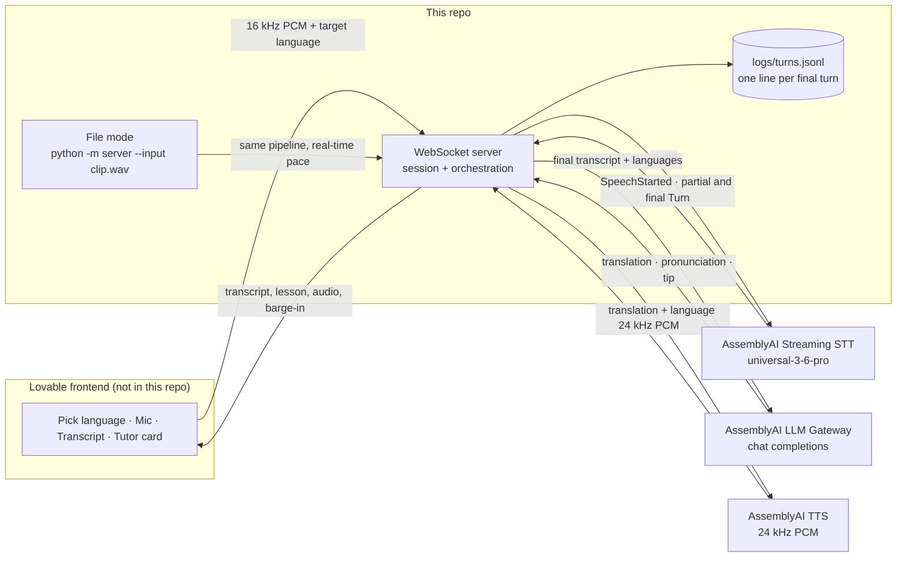

# Pingo

Pingo is a real-time voice tutor for language learners, built only on AssemblyAI. The learner says a word or phrase in any language Universal-3.6 Pro understands. The tutor answers with a translation, a pronunciation guide, and one short tip, then speaks the translation.

This repository is the **backend only**. The browser UI lives in Lovable and connects over one WebSocket. The API key never reaches the browser.



One turn:

1. The browser streams 16 kHz `pcm_s16le` audio. The server forwards it to streaming STT.
2. Partials update the transcript. `SpeechStarted` during a tutor reply cancels that reply and tells the browser to flush playback.
3. The final `Turn` (`end_of_turn: true`) carries words, confidence, and the detected language.
4. The LLM Gateway returns JSON: translation, pronunciation, tip, detected errors.
5. TTS speaks the translation. The server streams 24 kHz PCM back.
6. The server appends one JSONL line for that turn.

## Run it

```bash
python -m venv .venv
source .venv/bin/activate
pip install -r requirements.txt
cp .env.example .env
# put your key in .env — it is gitignored
python -m server
```

The server listens on `ws://localhost:8000/ws`. In the Lovable project, set:

```bash
VITE_BACKEND_WS_URL=ws://localhost:8000/ws
```

`localhost` works when the backend runs on the same machine as the browser. A local run binds `127.0.0.1:8000`. If `PORT` is set, that port is used instead. From another device, pass `--host 0.0.0.0`. `GET /health` returns `{"ok": true}`.

CORS is open so the Lovable-hosted page can connect. A new `start` on an existing socket closes the previous STT session and opens a fresh one. A dropped socket closes the upstream STT connection.

## Deploy on Render

`render.yaml` is a Blueprint for one free Python web service named `pingo-voice-backend`.

1. In Render: **New > Blueprint**, and pick this repo.
2. When it asks for `ASSEMBLYAI_API_KEY`, paste the key. The Blueprint does not contain a value.
3. After the deploy, set the Pingo app's backend URL to `wss://<service>.onrender.com/ws`.

The free tier sleeps after inactivity. The first connection after a sleep can take about 30–60 seconds while the service wakes up.

## WebSocket protocol

Client to server:

| Message | Meaning |
|---|---|
| `{"type":"start","target_language":"es","config":{...}}` | Open a streaming STT session. Optional `case_id` and `session_id`. |
| binary frames | PCM16 LE mono, 16 kHz, about 50 ms each |
| `{"type":"update_config","config":{...}}` | Merge into the session and forward STT fields via `UpdateConfiguration` |
| `{"type":"set_target","target_language":"fr"}` | Next reply uses this target. Does not reconnect STT. |
| `{"type":"replay","turn_order":N}` | Speak that turn's translation again. No second LLM call. |
| `{"type":"stop"}` | Close STT and append any turn line still held in memory. |

`target_language` is one of `en`, `es`, `fr`, `de`, `it`, `pt` (or the full name, `spanish`). Those are the six languages AssemblyAI TTS speaks.

Server to client:

| Message | Meaning |
|---|---|
| `{"type":"status","state":"listening"\|"thinking"\|"speaking"}` | Where the turn is |
| `{"type":"transcript",...}` | Partial or final. Fields: `turn_order`, `end_of_turn`, `transcript`, `language_code`, `language_confidence`, `words[{text,start,end,confidence,word_is_final}]`. Language is only filled on a final turn. |
| `{"type":"lesson",...}` | `turn_order`, `source_text`, `source_language`, `translation`, `target_language`, `pronunciation`, `tip` |
| `{"type":"agent_text","text","final"}` | The text TTS is about to speak (the translation). `final` is true. |
| `{"type":"tts_start","sample_rate":24000}` then binary PCM16 then `{"type":"tts_end"}` | Tutor audio |
| `{"type":"barge_in"}` | Learner spoke over the tutor. Flush playback. A `tts_end` may already have been sent; do not wait on it. |
| `{"type":"error","message"}` | A clean message. Timeouts say which call timed out. |

`config` on `start` / `update_config` accepts the flat STT fields (`language_codes`, `prompt`, `keyterms_prompt`, `agent_context`, `agent_context_enabled`, `mode`, `min_turn_silence`, `max_turn_silence`, `interruption_delay`, `vad_threshold`) and nested `stt` / `llm` / `tts` objects. An empty `prompt` does **not** clear the server prompt, because the current Lovable client sends `"prompt": ""` on every start. A non-empty prompt replaces it. `keyterms_prompt: []` does turn keyterms off.

## Config flags

Defaults live in `configs/baseline.yaml`. Override with another file (`--config`), the environment, or `--set stt.max_turn_silence=1800`.

| Flag | Default | Sent to STT? | Why |
|---|---|---|---|
| `stt.speech_model` | `universal-3-6-pro` | yes | 32 languages, native code-switching |
| `stt.language_detection` | `true` | yes | `language_code` and `language_confidence` on final turns only |
| `stt.language_codes` | `[]` (omitted) | only when non-empty | Empty means code-switching across all 32. A list biases those languages and still allows switching among them. |
| `stt.prompt` | short learner context | when non-empty | Context about the audio, not instructions. Max 1750 characters. |
| `stt.keyterms_prompt` | `[]` (omitted) | when non-empty | **Off in the baseline.** The main A/B test. Boosting the target phrase can make STT "hear" the correct form. Max 100 terms, 50 characters each. |
| `stt.mode` | `balanced` | yes | Turn-taking preset. `min_latency` cuts pauses at 640 ms. `max_accuracy` waits 2560 ms. Balanced is 128 / 1280 ms. |
| `stt.interruption_delay` | `500` | yes | How soon the first partial is emitted. The server adds 256 ms. Balanced and max-accuracy use 500; min-latency uses 0. |
| `stt.min_turn_silence` | unset | only when set | Silence before an end-of-turn check. Leave unset to keep the mode preset. |
| `stt.max_turn_silence` | unset | only when set | Silence that forces the turn to end. The main lever for hesitant-pause cutoffs. |
| `stt.vad_threshold` | unset (server default 0.2) | only when set | Raise it if echo or noise causes false barge-ins. |
| `stt.agent_context_enabled` | `false` | — | When true, after each reply the server sends `UpdateConfiguration` with `agent_context` set to the spoken translation (max 1750 characters). Same fidelity risk as keyterms, so the baseline leaves it off. |
| `llm.model` | `qwen3.5-4b-32k-fast` | — | The model this key can call that does not support `response_format`. `gemma-4-31b` is the other allowed model, and that one does support `response_format`. Anything else, including `gemini-2.5-flash-lite`, returns 400. |
| `llm.temperature` | `0.2` | logged, not sent | The playground body is only `model` and `messages`. Temperature stays in the JSONL config. |
| `llm.stream` | `false` | no | The playground call is one POST. `llm_first_token` is null. |
| `llm.timeout_s` | `30` | — | Overall deadline. The client gets "The tutor model timed out after 30 seconds." |
| `llm.system_prompt` | see `server/config.py` | — | Must not silently correct the learner. It has to name the specific difference. `{target}` is replaced with the language name. |
| `tts.voices.*` | catalog default per language | `voice_id` | `english`→`aai-kyla`, `spanish`→`aai-antonioluis`, `french`→`aai-donatien`, `german`→`aai-magdalena`, `italian`→`aai-giada`, `portuguese`→`aai-nelson`. TTS `language` is the full name. |
| `tts.timeout_s` | `30` | — | "Speech synthesis timed out after 30 seconds." |

`end_of_turn_confidence_threshold` is not a universal-3-6-pro parameter and is never sent. Final turns do include `end_of_turn_confidence`; it is stored on the JSONL line and is **not** used to start the LLM early.

Environment variables (all optional): `PINGO_STT_MODE`, `PINGO_STT_PROMPT`, `PINGO_STT_LANGUAGE_CODES`, `PINGO_STT_KEYTERMS_PROMPT` (JSON or comma-separated), `PINGO_STT_AGENT_CONTEXT`, `PINGO_STT_AGENT_CONTEXT_ENABLED`, `PINGO_STT_MIN_TURN_SILENCE`, `PINGO_STT_MAX_TURN_SILENCE`, `PINGO_STT_INTERRUPTION_DELAY`, `PINGO_STT_VAD_THRESHOLD`, `PINGO_LLM_MODEL`, `PINGO_LLM_TEMPERATURE`, `PINGO_LLM_MAX_TOKENS`, `PINGO_LLM_STREAM`, `PINGO_LLM_TIMEOUT`, `PINGO_LLM_SYSTEM_PROMPT`, `PINGO_TTS_TIMEOUT`, `PINGO_TTS_VOICE_SPANISH` (or `_ES`, and the same for the other five), `PINGO_LOG_PATH`, `PINGO_HOST`, `PINGO_PORT`, `PINGO_TARGET_LANGUAGE`, `PINGO_CONFIG`.

Example configs: `configs/baseline.yaml` and `configs/keyterms_on.yaml`. For a real keyterms run, replace the sample terms with that case's target phrase.

## File mode and the turn log

File mode runs the **same** session class as the WebSocket. Audio is converted to 16 kHz mono PCM16 if needed, then sent in 50 ms chunks **at real-time pace**, then two seconds of silence (longer when `max_turn_silence` is raised) so endpointing can emit the final turn.

```bash
python -m server \
  --input clips/pm-es-01.wav \
  --case-id pm-es-01 \
  --session-id baseline-pm-es-01-1 \
  --log logs/turns.jsonl \
  --config configs/baseline.yaml
```

- `--case-id` is copied onto every line. A live session leaves it null.
- `--session-id` must be **unique per run** so repeated cases are not merged. If you omit it, the process generates a UUID.
- `--log` is **appended**, never overwritten. Several runs can share one file. Default path is `logs/turns.jsonl` (gitignored).
- The process exits after the last turn's tutor reply is logged, or after a timeout. Exit 0 when at least one line was written, 1 when it wasn't, 2 when `ASSEMBLYAI_API_KEY` is missing.
- The spoken audio is also written to `logs/last_reply.pcm` (24 kHz mono s16). Play it with `ffplay -f s16le -ar 24000 -ch_layout mono logs/last_reply.pcm`.

One JSONL object per final STT turn, written once the tutor reply has finished or been interrupted:

```json
{
  "case_id": "pm-es-01",
  "session_id": "baseline-pm-es-01-1",
  "turn_order": 0,
  "config": {
    "speech_model": "universal-3-6-pro",
    "mode": "balanced",
    "language_codes": [],
    "keyterms_prompt": [],
    "llm_model": "qwen3.5-4b-32k-fast",
    "temperature": 0.2,
    "llm_done": "full_response"
  },
  "stt": {
    "transcript": "Yo soy mucho frío.",
    "words": [{"text": "Yo", "start": 520, "end": 700, "confidence": 0.97}],
    "language_code": "es",
    "language_confidence": 0.95,
    "end_of_turn_confidence": 1.0
  },
  "llm": {
    "model": "qwen3.5-4b-32k-fast",
    "translation": "Tengo mucho frío.",
    "pronunciation": "TEN-go MOO-cho FREE-o",
    "tip": "Use tener for age and for being cold.",
    "detected_errors": ["soy -> tengo"]
  },
  "barge_in": false,
  "timings_ms": {
    "speech_end": 1731300000000,
    "stt_final": 1731300000250,
    "llm_first_token": 1731300000550,
    "llm_done": 1731300000850,
    "tts_first_audio": 1731300000970
  },
  "usage": {
    "stt_audio_seconds": 4.0,
    "llm_input_tokens": 350,
    "llm_output_tokens": 80,
    "tts_characters": 40
  }
}
```

`detected_errors` is omitted when the model never returned a lesson (for example a barge-in during the LLM call). An empty list means the model returned a lesson and flagged nothing. Each string is `heard -> issue`.

Extra keys the scorer can ignore: `stt.words[].word_is_final`, `stt_partial_first`, `stt_partials`, `stt_session_id`, `end_of_turn_reason`, `tts_audio_ms`, and the rest of `config` (prompt, silence thresholds, voices). `config.llm_done` is `full_response`: TTS starts only after the whole lesson JSON is parsed, not at the first token.

### Timings

All five `timings_ms` values are wall-clock epoch milliseconds from `time.time()`, so subtractions are real durations. A null value means that stage did not happen.

| Field | Moment |
|---|---|
| `speech_end` | Last word's `end` (milliseconds from the start of audio sent to STT) plus the wall clock of the first audio byte. `stream_start + words[-1].end`. |
| `stt_final` | This process receives the `Turn` with `end_of_turn: true`. |
| `llm_first_token` | First streamed token. Null when the model did not stream. |
| `llm_done` | The full lesson JSON is parsed. |
| `tts_first_audio` | This process receives the first TTS audio byte. Not browser playback. |

`usage.stt_audio_seconds` is the audio forwarded to STT that belongs to that turn, including silence. Each turn owns the bytes from the previous turn's final up to its own final. The last turn also owns whatever was sent after its final (the endpointing silence, and any audio during the reply). The lines of one `session_id` therefore sum to the audio this process forwarded. Streaming is billed on session audio; confirm the price on AssemblyAI's pricing page before quoting a dollar cost.

## Key decisions

1. **Split repos.** The frontend is in Lovable. This repo is one WebSocket server and three AssemblyAI clients. The key stays in `.env`.
2. **All AssemblyAI.** Universal-3.6 Pro Realtime, then the LLM Gateway, then TTS. One key, one vendor. The deprecated managed Voice Agent API is not used.
3. **`universal-3-6-pro` with `language_detection=true`.** The model code-switches across its languages in one stream. The detected language is shown to the learner and passed to the tutor.
4. **`mode=balanced`, with `max_turn_silence` exposed.** Learners hesitate. Balanced waits up to 1280 ms. Raising `max_turn_silence` is the cutoff experiment. `min_turn_silence` and `vad_threshold` stay at the preset unless a run sets them.
5. **`mode` and `interruption_delay` are sent.** A live check on Nov 10, 2026 (PT) showed `mode` echoed on `universal-3-6-pro`. `interruption_delay` is validated (a value outside 0–1000 ms returns error 3006) but is not in the SessionBegins echo. `prompt` was not rejected and was not echoed, so it stays unconfirmed. See below.
6. **`keyterms_prompt` off by default.** It protects error preservation. `configs/keyterms_on.yaml` turns it on. Enable it in production only if the eval shows no loss on planted mistakes.
7. **`agent_context` off by default.** When enabled, the tutor's last spoken line is sent with `UpdateConfiguration` so a short repeat ("estación") has context. Same risk as keyterms: it can erase the mistake you wanted to hear.
8. **Barge-in on `SpeechStarted`.** That event fires only once there is a real transcript, not on noise. It cancels an in-flight LLM or TTS call and sends `barge_in`.
9. **Six target languages.** English, Spanish, French, German, Italian, Portuguese. The UI should not offer Japanese or Hindi as something the tutor can speak.
10. **JSON from the prompt, not `response_format`.** The default model, `qwen3.5-4b-32k-fast`, does not support `response_format`. The system prompt asks for `{translation, pronunciation, tip, detected_errors}` and the server parses that text, stripping code fences. If the reply is not JSON, the whole text is used as the translation. `gemma-4-31b` is the other model this key can call, and it does support `response_format`; the client still uses the same prompt-and-parse path. The prompt also says to never silently correct the transcript and to name the specific difference.
11. **Separate chat-completions call, not the streaming `llm_gateway` parameter.** The lesson has to be structured so the card and the scorer can read it, and the stage timings have to be ours. The streaming `llm_gateway` query parameter can run a prompt inside the STT socket and would save a network hop, but a failed gateway call returns nothing. Using it would need its own timeout and a fallback to this chat-completions call. That is a latency experiment, not the baseline. We also do not start the LLM on a partial, no matter how high `end_of_turn_confidence` is.
12. **File mode plus one JSONL line per final turn.** Live and eval share `Session`, so the latency numbers come from the same code path. The log is append-only.

## Live verification

Checked against the real API on Nov 10, 2026 (PT), on commit `e2326c3` and the follow-up client change.

**LLM Gateway.** This key can call two models:

| Model | `response_format` | What we do |
|---|---|---|
| `qwen3.5-4b-32k-fast` (default) | not supported | Ask for JSON in the system prompt and parse the text |
| `gemma-4-31b` | supported | Same prompt-and-parse path. Switch with `--set llm.model=gemma-4-31b` |

Every other model, including `gemini-2.5-flash-lite`, returns HTTP 400: `Your account does not have access to this LLM Gateway model`.

**Streaming parameters on `universal-3-6-pro`.**

| Parameter | Result |
|---|---|
| `mode` | Accepted. The SessionBegins echo returns the value that was sent. |
| `interruption_delay` | Validated. A value outside 0–1000 ms returns error 3006, `must be between 0 and 1000 ms`. It is not in the SessionBegins echo. |
| `prompt` | Not rejected, and not echoed. Unconfirmed: the server may be applying it or ignoring it. |

The server sends `mode` (default `balanced`) and `interruption_delay` (default 500), and sends `prompt` when it is non-empty. It does not send `end_of_turn_confidence_threshold`. The SDK's `set_params` model has no `mode` field, so a mid-session mode change waits for the next `start`.

Re-check with a key:

```bash
python scripts/verify_params.py
```

A file-mode run:

```bash
python -m server --input clip.wav --case-id smoke-1 --session-id smoke-1 --log logs/turns.jsonl
```

Confirm a transcript, a lesson on stdout, and audio in `logs/last_reply.pcm`.

## Tests

```bash
python -m unittest discover -s tests -t .
```

The tests fake the SDK streaming client and the gateway `requests.post`. They cover the eval JSONL line, append-only logging, barge-in, replay, a second `start`, and one WebSocket turn.

Speech-to-text uses AssemblyAI's Python SDK `RealTimeTranscriber` (the streaming playground pattern). Text-to-speech uses the SDK `TextToSpeech.stream` call. The lesson uses the LLM Gateway playground `requests.post` shown above, with header `authorization: <key>` and no `Bearer` prefix. SDK version: `assemblyai==1.9.1`.

## Known gaps

- TTS speaks six languages. STT understands many more, so the tutor cannot yet teach Japanese or Hindi.
- There is no phoneme-level pronunciation score. Low word confidence and `detected_errors` are the signals.
- `keyterms_prompt` and `agent_context` may normalize learner mistakes. Both are off until an eval says otherwise.
- Language id arrives only on final turns, so the UI cannot show "you spoke: Spanish" while the person is still talking.
- `SpeechStarted` needs a real transcript, so barge-in is slightly late by design. Browser echo can still false-trigger it; headphones or a higher `vad_threshold` help.
- No accounts, history, auth, or rate limiting. This is a reference server.
- Prices for the cost KPI were not confirmed. `usage` has the quantities; multiply by the current price list.
- The speech-end mapping assumes STT word times start at the first audio byte this process sent. `verify_params.py` does not check that clock. Compare `stt_final - speech_end` on a real clip before publishing latency numbers.
- TTS is not started from a partial LLM token. Doing that is the next latency lever after the `llm_gateway` fallback sketched above.

## Layout

| Path | What it does |
|---|---|
| `server/__main__.py` | CLI: WebSocket server, or `--input` file mode |
| `server/app.py` | FastAPI app, `GET /health`, `WS /ws` |
| `server/session.py` | One learner session: STT events, lesson, TTS, barge-in, log |
| `server/stt.py` | SDK `RealTimeTranscriber` and the parameter rules |
| `server/llm.py` | Playground `requests.post` to the LLM Gateway |
| `server/tts.py` | SDK `TextToSpeech.stream` |
| `server/config.py` | Defaults, YAML, env, `--set`, per-session merge |
| `server/audio.py` | WAV to 16 kHz mono PCM16, real-time chunking |
| `server/log.py` | Append one JSONL line |
| `configs/` | `baseline.yaml`, `keyterms_on.yaml` |
| `scripts/verify_params.py` | Live check of `prompt`, `mode`, `interruption_delay` |
